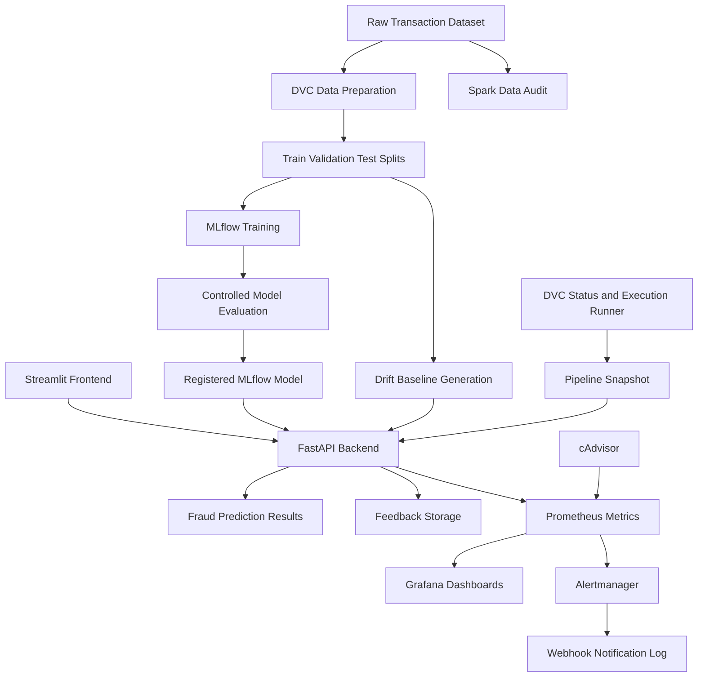

# AIOps Fraud Risk Monitor
## System Architecture Document

**Version:** 1.0
**Date:** 14 November 2026
**Project:** AIOps Fraud Risk Monitor

---

## 1. Introduction

Fraud Risk Monitor is a containerised machine-learning application
for transaction fraud risk scoring and operational monitoring.

The project combines:

- DVC for reproducible data processing
- Apache Spark for dataset auditing
- MLflow for experiment tracking and model registration
- FastAPI for fraud prediction APIs
- Streamlit for the user interface
- Prometheus and cAdvisor for metrics collection
- Grafana for visual monitoring
- Alertmanager and a webhook for alert notifications
- Docker Compose for service orchestration

The system separates offline model development from online inference.

## 2. System Architecture

The Spark audit is an independent DVC stage using the raw dataset.
Training and final evaluation are controlled MLflow operations
outside the DVC pipeline.

## 3. Dataset and Data Engineering

The source dataset contains:

| Property | Value |
|---|---|
| Total transactions | 284,807 |
| Fraud transactions | 492 |
| Input features | V1 to V28 and Amount |
| Target column | Class |

The DVC pipeline contains four stages:

| Stage | Purpose |
|---|---|
| prepare_data | Clean and prepare raw transaction data |
| create_splits | Create training, validation and test datasets |
| spark_audit | Audit the original dataset using Spark |
| build_drift_baseline | Create a reference distribution from training data |

DVC records stage dependencies and output metadata.

### Spark execution evidence

A real Spark audit execution produced:

- Execution status: succeeded
- Rows processed: 284,807
- Duration: 15.398599 seconds
- Throughput: 18,495.64 rows/second

The throughput measures end-to-end execution and includes
DVC and Spark startup/shutdown overhead.

## 4. Machine Learning Architecture

The model lifecycle is managed through MLflow.

The project contains separate entry points for training
and final evaluation in the MLproject configuration.

MLflow records parameters, metrics, tags and model artifacts.

### Approved deployment

| Property | Value |
|---|---|
| Algorithm | Logistic Regression pipeline |
| Registered model | FraudRiskClassifier |
| Version | 1 |
| Model run | 27da3507bddb413bab9cd0a12aeb092a |
| Evaluation run | 008277161614417d8da7e13727013676 |
| Decision threshold | 0.87292890258894895 |

The deployed model returns an uncalibrated model score.

Transactions scoring at or above the threshold are labelled
`review`; other transactions are labelled `normal`.

A review decision does not confirm that fraud occurred.

Model retraining is not triggered automatically.

## 5. FastAPI Backend

The backend loads the approved MLflow model and exposes:

| Method | Endpoint | Purpose |
|---|---|---|
| GET | /health | API and model health |
| POST | /predict | Single-transaction prediction |
| POST | /predict/csv | CSV batch prediction |
| GET | /metrics | Prometheus metrics |
| POST | /feedback | Save corrected-label feedback |
| POST | /monitoring/validation-failure | Record upload validation failures |
| GET | /monitoring/pipeline-status | Retrieve saved pipeline status |

Single predictions require exactly 29 numeric input features.

CSV uploads are limited to 50 MiB and 100,000 rows.

Invalid features, non-finite values and negative amounts
are rejected by the backend.

## 6. Streamlit Frontend

The Streamlit interface provides:

- Single-transaction fraud scoring
- CSV batch prediction
- Bulk ZIP processing through the application interface
- Prediction-result review and feedback submission
- Pipeline overview and recorded execution history
- Information about the connected prediction API

Streamlit communicates with FastAPI using the Docker service network.

## 7. Monitoring and Observability

### Prometheus

Prometheus scrapes metrics every 15 seconds from:

- FastAPI backend
- cAdvisor
- Prometheus
- Grafana

Backend metrics include HTTP requests, request duration,
transactions scored, feature drift and feedback indicators.

### Drift monitoring

For CSV uploads containing at least 100 rows, the backend
calculates Population Stability Index (PSI) against the
training-derived drift baseline.

Drift analysis is best-effort and does not block valid scoring
when monitoring encounters an error.

### Feedback monitoring

Authorized feedback is stored in a local JSONL file.

Feedback monitoring reports available observations, but
limited or unverified feedback must not be treated as
reliable production-model accuracy.

### Grafana

Grafana provides dashboards for application activity,
fraud scoring, drift, feedback and infrastructure metrics.

### Alertmanager

Prometheus has five validated alert rules.

Alertmanager receives alerts and sends notifications to
a local Python webhook that records notification details
in JSONL format.

A controlled test notification was successfully delivered
and the temporary alert subsequently cleared.

## 8. Pipeline Monitoring

DVC pipeline status is collected into a saved JSON snapshot.

The pipeline overview shows:

- The four declared DVC stages
- Stage dependency and up-to-date information
- Spark audit results
- Recorded execution success or failure
- Measured execution duration and throughput

The execution runner maintains a local JSONL history.

The snapshot can include up to 20 recent execution records.

The monitoring API reads the saved snapshot; it does not
execute DVC commands when handling requests.

This is snapshot-based monitoring, not a live job scheduler.

## 9. Docker Deployment

Docker Compose defines seven services.

| Service | Responsibility | Host port |
|---|---|---|
| backend | FastAPI and model inference | 127.0.0.1:8000 |
| frontend | Streamlit web interface | 8501 |
| prometheus | Metrics and alert evaluation | 127.0.0.1:9091 |
| grafana | Monitoring dashboards | 127.0.0.1:3001 |
| alertmanager | Notification routing | 127.0.0.1:9093 |
| cadvisor | Container resource metrics | Internal 8080 |
| alert-webhook | Local alert recording | Internal 8085 |

Prometheus and Grafana use persistent Docker volumes.

MLflow metadata, model artifacts, feedback files and
pipeline-status data are mounted into the backend as needed.

The backend and frontend run as non-root container users.

## 10. Security

The application implements:

- Token-protected feedback submission
- Token-protected pipeline monitoring access
- API input validation
- Non-root backend and frontend containers
- Read-only model artifact and pipeline snapshot mounts
- Environment-based secret configuration
- Localhost bindings for several operational services

The Streamlit service binds to all host network interfaces.

The current deployment is intended for local academic use,
not as a fully hardened production banking system.

## 11. Testing and Verification

Verified evidence includes:

| Verification | Result |
|---|---|
| Local automated tests | 111 passed |
| Portable CI tests | 105 passed |
| Backend Docker build | Passed |
| Frontend Docker build | Passed |
| DVC status | Up to date |
| Spark audit | Successfully executed |
| Registered MLflow model | Version 1, READY |
| Docker services | 7 running |
| FastAPI health endpoint | HTTP 200 |
| Prometheus alert rules | 5 valid |
| Webhook delivery test | Passed |

A GitHub Actions workflow is configured for portable tests
and Docker builds.

However, hosted GitHub Actions execution has not yet been
verified because the local repository has no Git remote.

## 12. Limitations

- The system operates on historical transaction data.
- Model scores are not calibrated fraud probabilities.
- Feedback does not automatically trigger retraining.
- Execution history captures only runs using the stage runner.
- Pipeline snapshots may become stale.
- Production authentication and network hardening are outside
  the scope of this local academic deployment.
- Hosted GitHub Actions execution remains unverified.

## 13. Conclusion

Fraud Risk Monitor integrates reproducible data engineering,
controlled machine-learning experiments, model deployment,
operational monitoring and alerting.

The architecture separates offline training from online inference
and supports traceable predictions, recorded pipeline executions
and observable service behaviour.

Its primary technical components have been verified using
automated tests and targeted integration checks.
