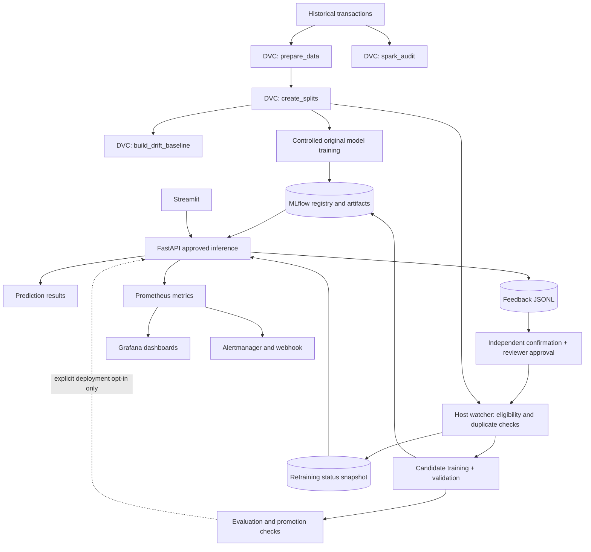
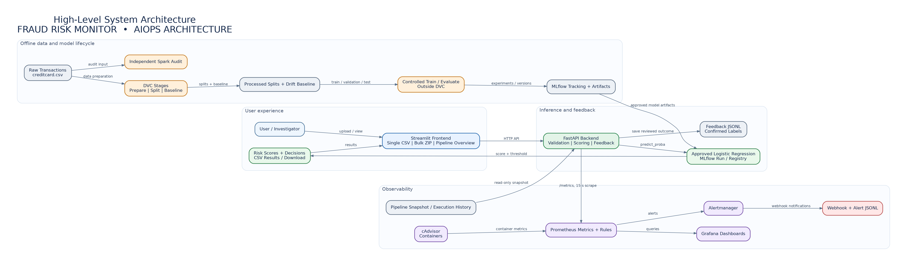

# AIOps Fraud Risk Monitor
## System Architecture Document

**Version:** 1.1
**Date:** 19 November 2026
**Project:** AIOps Fraud Risk Monitor

---

## 1. Introduction

Fraud Risk Monitor is a containerised machine-learning application
for transaction fraud risk scoring and operational monitoring.

The project combines:

- DVC for reproducible data processing
- Apache Spark for dataset auditing and data transformation
- MLflow for experiment tracking, model registration and native model serving
- FastAPI for fraud prediction and explanation APIs
- Fernet (cryptography) for encryption of stored feedback
- Streamlit for the user interface
- Prometheus and cAdvisor for metrics collection
- Grafana for visual monitoring
- Alertmanager and a webhook for alert notifications
- Docker Compose for service orchestration
- Separate host-side watcher for approved-feedback candidate retraining

The system separates offline model development from online inference.

## 2. System Architecture

The Spark audit is an independent DVC stage using the raw dataset.
Training and final evaluation are controlled MLflow operations
outside the DVC pipeline.

## 3. Dataset and Data Engineering

The source dataset contains:

| Property | Value |
|---|---|
| Total transactions | 284,807 |
| Fraud transactions | 492 |
| Input features | V1 to V28 and Amount |
| Target column | Class |

The DVC pipeline contains seven stages, rooted at the DVC-versioned raw dataset (`data/raw.dvc`):

| Stage | Purpose |
|---|---|
| prepare_data | Clean and prepare raw transaction data |
| create_splits | Create training, validation and test datasets |
| spark_audit | Audit the original dataset using Spark |
| spark_transform | Ingest, validate and enrich raw data with Spark into partitioned Parquet |
| build_drift_baseline | Create a reference distribution from training data |
| eda | Regenerate exploratory charts and summary |
| train_baselines | Train candidate models from `params.yaml`; log metrics and feature importance to MLflow |

DVC records stage dependencies and output metadata.

### Spark transformation stage

`scripts/spark_transform.py` (DVC stage `spark_transform`) is the Spark ingestion/transformation pipeline: explicit-schema FAILFAST ingest of the raw CSV, distributed validation, engineered columns (`log_amount`, `is_zero_amount`, `amount_zscore`, SHA-256 `feature_hash`, window-based `duplicate_count`), and Snappy Parquet output partitioned by `Class` in `data/processed/spark_features/`. Throughput (rows/second) is written to `metrics/spark_transform.json` and shown by `dvc metrics show`.

### Spark execution evidence

A real Spark audit execution produced:

- Execution status: succeeded
- Rows processed: 284,807
- Duration: 15.398599 seconds
- Throughput: 18,495.64 rows/second

The throughput measures end-to-end execution and includes
DVC and Spark startup/shutdown overhead.

## 4. Machine Learning Architecture

The model lifecycle is managed through MLflow.

The project contains separate entry points for training
and final evaluation in the MLproject configuration.

MLflow records parameters, metrics, tags and model artifacts.

### Approved deployment

| Property | Value |
|---|---|
| Algorithm | Logistic Regression pipeline |
| Registered model | FraudRiskClassifier |
| Version | 1 |
| Model run | 27da3507bddb413bab9cd0a12aeb092a |
| Evaluation run | 008277161614417d8da7e13727013676 |
| Decision threshold | 0.87292890258894895 |

The deployed model returns an uncalibrated model score.

Transactions scoring at or above the threshold are labelled
`review`; other transactions are labelled `normal`.

A review decision does not confirm that fraud occurred.

A host-side watcher can initiate candidate retraining from sufficiently approved and eligible feedback. It is separate from DVC and the eight Docker Compose services. Model promotion is validated independently; **automatic live deployment remains off unless explicitly enabled**.

### Feedback-driven candidate lifecycle

1. Store submitted outcomes in `data/feedback/feedback.jsonl`.
2. Independently confirm outcomes and record reviewer approvals in `approved_feedback.jsonl`.
3. Screen for invalid, duplicate or existing train/validation/test transactions.
4. Require at least 20 eligible labels, including 3 fraud and 3 legitimate examples.
5. Train a new candidate using original training rows plus eligible approved feedback; evaluate with validation data and log MLflow artifacts.
6. Run separate candidate evaluation and promotion checks; preserve the current deployed model by default.
7. Publish a read-only status snapshot to `data/feedback/retraining_monitor.json`. The held-out test split is not used to select candidates.

## 5. FastAPI Backend

The backend loads the approved MLflow model and exposes:

| Method | Endpoint | Purpose |
|---|---|---|
| GET | /health | API and model health |
| POST | /predict | Single-transaction prediction |
| POST | /predict/csv | CSV batch prediction |
| POST | /explain | Prediction with per-feature contributions |
| GET | /metrics | Prometheus metrics |
| POST | /feedback | Save corrected-label feedback |
| POST | /monitoring/validation-failure | Record upload validation failures |
| GET | /monitoring/pipeline-status | Retrieve saved pipeline status |
| GET | /monitoring/retraining-status | Retrieve authenticated feedback/retraining eligibility snapshot |

Single predictions require exactly 29 numeric input features.

CSV uploads are limited to 50 MiB and 100,000 rows.

Invalid features, non-finite values and negative amounts
are rejected by the backend.

## 6. Streamlit Frontend

The Streamlit interface provides:

- Single-transaction fraud scoring
- CSV batch prediction
- Bulk ZIP processing through the application interface
- Prediction-result review and feedback submission
- "Why was a row scored this way?" explanation chart
- Pipeline overview and recorded execution history
- Information about the connected prediction API
- Authenticated retraining eligibility and approval-status display

Streamlit communicates with FastAPI using the Docker service network.

## 7. Monitoring and Observability

### Prometheus

Prometheus scrapes metrics every 15 seconds from:

- FastAPI backend
- cAdvisor
- Prometheus
- Grafana

Backend metrics include HTTP requests, request duration,
transactions scored, feature drift and feedback indicators.

### Drift monitoring

For CSV uploads containing at least 100 rows, the backend
calculates Population Stability Index (PSI) against the
training-derived drift baseline.

Drift analysis is best-effort and does not block valid scoring
when monitoring encounters an error.

### Feedback monitoring

The worker writes eligible, unapproved and per-class feedback counts to a snapshot. FastAPI serves only validated aggregate fields through a token-protected read-only route. This is not an automatic deployment control.

Authorized feedback is stored in a local JSONL file.

Feedback monitoring reports available observations, but
limited or unverified feedback must not be treated as
reliable production-model accuracy.

### Grafana

Grafana provides dashboards for application activity,
fraud scoring, drift, feedback and infrastructure metrics.

### Alertmanager

Prometheus has five validated alert rules.

Alertmanager receives alerts and sends notifications to
a local Python webhook that records notification details
in JSONL format.

A controlled test notification was successfully delivered
and the temporary alert subsequently cleared.

## 8. Pipeline Monitoring

DVC pipeline status is collected into a saved JSON snapshot.

The pipeline overview shows:

- The seven declared DVC stages
- Stage dependency and up-to-date information
- Spark audit results
- Recorded execution success or failure
- Measured execution duration and throughput

The execution runner maintains a local JSONL history.

The snapshot can include up to 20 recent execution records.

The monitoring API reads the saved snapshot; it does not
execute DVC commands when handling requests.

This is snapshot-based monitoring, not a live job scheduler.

## 9. Docker Deployment

Docker Compose defines eight services. The retraining watcher is an **additional host-side process** and is not counted as a Docker service.

| Service | Responsibility | Host port |
|---|---|---|
| backend | FastAPI and model inference | 127.0.0.1:8000 |
| mlflow-serve | MLflow native scoring server (`/invocations`, `/ping`) | 127.0.0.1:5001 |
| frontend | Streamlit web interface | 8501 |
| prometheus | Metrics and alert evaluation | 127.0.0.1:9091 |
| grafana | Monitoring dashboards | 127.0.0.1:3001 |
| alertmanager | Notification routing | 127.0.0.1:9093 |
| cadvisor | Container resource metrics | Internal 8080 |
| alert-webhook | Local alert recording | Internal 8085 |

Prometheus and Grafana use persistent Docker volumes.

MLflow metadata, model artifacts, feedback files and
pipeline-status data are mounted into the backend as needed.

The backend, frontend and MLflow serving containers run as non-root users.

The MLflow server loads the model by its source run URI
(`runs:/27da3507bddb413bab9cd0a12aeb092a/model`) because the
artifact store is mounted read-only and registry-name loading
would try to write metadata into it.

## 10. Security

**Encryption at rest.** Feedback feature vectors are encrypted with Fernet (AES-128-CBC + HMAC-SHA256) using `FEEDBACK_ENCRYPTION_KEY` from the git-ignored `.env` before being written to `data/feedback/feedback.jsonl`. Stored records carry `features_encrypted` and `encryption: "fernet-v1"` instead of plaintext `features`; `backend/feedback_crypto.record_features()` decrypts for retraining and rejects tampered tokens or a wrong key. Compose refuses to start the backend without the key.

The application implements:

- Token-protected feedback submission
- Token-protected pipeline and retraining-status monitoring access
- API input validation
- Non-root backend and frontend containers
- Read-only model artifact and pipeline snapshot mounts
- Environment-based secret configuration
- Localhost bindings for several operational services

The Streamlit service binds to all host network interfaces.

The current deployment is intended for local academic use,
not as a fully hardened production banking system.

## 11. Testing and Verification

Verified evidence includes:

| Verification | Result |
|---|---|
| Full pytest suite (Ubuntu VM, 19 Nov 2026) | 160 passed, 0 failed |
| GitHub Actions hosted CI | Passed on commit `96b8113` |
| Targeted deployment tests after CI fixture fix | 5 passed |
| Backend Docker build | Passed |
| Frontend Docker build | Passed |
| MLflow serving Docker build | Passed (CI) |
| Spark transformation | 284,807 rows in 13.95 s (20,411.6 rows/s) |
| MLflow scoring server | Healthy; `/invocations` returns predictions |
| DVC status | Up to date |
| Spark audit | Successfully executed |
| Registered MLflow model | Version 1, READY |
| Docker services | 8 running |
| FastAPI health endpoint | HTTP 200 |
| Prometheus alert rules | 5 valid |
| Webhook delivery test | Passed |

The GitHub Actions workflow executes portable unit/integration tests and builds both Docker images. The verified run for commit `96b8113` passed. Local dataset-dependent and deployed-model tests require the developer environment.

## 12. Scope and Validation Boundaries

- The system uses historical transactions in a local academic deployment; live banking operations were not evaluated.
- Model scores are uncalibrated, and review decisions do not independently confirm fraud.
- Candidate retraining requires verified, approved feedback. Automatic live deployment is disabled by default; rollback safeguards were tested in isolation.
- Pipeline history records runs captured by the stage runner, and saved snapshots can become stale. Production authentication, TLS and key rotation have not been established; stored feedback is encrypted at rest.

## 13. Conclusion

Fraud Risk Monitor integrates reproducible data engineering,
controlled machine-learning experiments, model deployment,
operational monitoring and alerting.

The architecture separates offline training from online inference
and supports traceable predictions, recorded pipeline executions
and observable service behaviour.

Its primary technical components have been verified using
automated tests and targeted integration checks.
