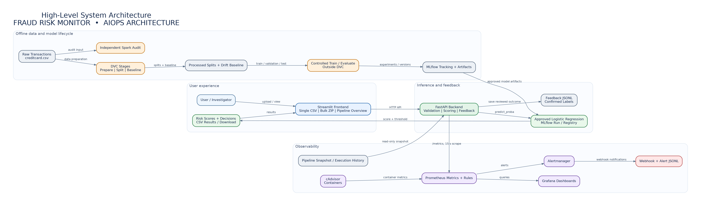
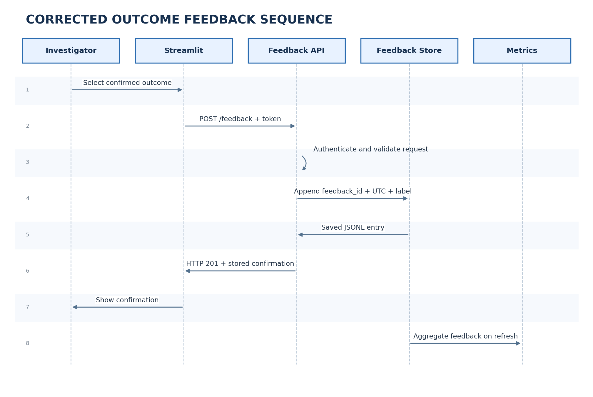

# AIOps Fraud Risk Monitor
## High-Level Design Document

**Project:** AIOps Fraud Risk Monitor
**Version:** 1.1 — 19 November 2026

---

## 1. Purpose

This document describes the high-level design of the
Fraud Risk Monitor application.

It focuses on modules, responsibilities, workflows,
data movement, integration and design decisions.

The detailed API schemas are covered separately in
the Low-Level Design and API Specification.

## 2. System Objectives

The application is designed to:

1. Score individual financial transactions.
2. Process transaction CSV files.
3. Support bulk file processing through Streamlit.
4. Identify transactions requiring review.
5. Collect authorised prediction feedback.
6. Monitor data drift and application performance.
7. Display DVC pipeline status and execution history.
8. Provide observable, containerised deployment.
9. Support independently approved feedback-driven candidate retraining without automatically replacing the active model.

## 3. Major Functional Modules

| Module | Technology | Responsibility |
|---|---|---|
| Data preparation | Python, DVC | Clean transaction data |
| Data splitting | Python, DVC | Create train, validation and test splits |
| Dataset auditing | PySpark, DVC | Check source data quality |
| Drift baseline | Python, DVC | Generate reference feature distributions |
| Model development | Scikit-learn, MLflow | Train and track candidate models |
| Model evaluation | MLflow | Record controlled evaluation results |
| Prediction service | FastAPI | Serve the approved model |
| User interface | Streamlit | Accept inputs and display results |
| Feedback service | FastAPI, JSONL | Store corrected labels |
| Reviewer approval | Host-side Python CLI, JSONL | Record independent approval and label integrity |
| Candidate retraining worker | Python, MLflow | Check eligible feedback and train candidate when thresholds are met |
| Candidate evaluation and promotion | Python, MLflow | Apply validation gates and preserve approved model unless deployment explicitly enabled |
| Retraining status endpoint | FastAPI, JSON | Serve token-protected aggregate snapshot |
| Pipeline monitoring | DVC, JSON snapshot | Display pipeline state and recorded runs |
| Observability | Prometheus, Grafana | Record and visualise metrics |
| Alert processing | Alertmanager, Python | Route and record notifications |
| Containerisation | Docker Compose | Deploy application services |

## 4. Offline Data Processing Workflow

The offline workflow begins with the historical
credit-card transaction dataset.

Data preparation creates the processed dataset.

The splitting stage generates separate training,
validation and test datasets.

The training split is also used to generate the
drift-monitoring baseline.

A separate Spark stage audits the original dataset.

DVC tracks dependencies and outputs for these stages.

The pipeline currently has four DVC stages.

## 5. Model Development Workflow

Training and evaluation are controlled MLflow operations.

The training workflow:

1. Loads prepared training and validation data.
2. Trains candidate classification models.
3. Calculates validation metrics.
4. Logs parameters, metrics and artifacts to MLflow.
5. Saves model artifacts.

The final evaluation workflow records results
against the selected model.

The approved Logistic Regression model is registered
as FraudRiskClassifier version 1.

Routine prediction requests do not initiate training.

## 6. Single-Transaction Prediction Workflow

1. A user submits transaction features through Streamlit.
2. Streamlit calls the FastAPI prediction endpoint.
3. FastAPI validates the 29 expected features.
4. The approved MLflow model calculates a score.
5. FastAPI compares the score against the approved threshold.
6. FastAPI returns a normal or review decision.
7. Streamlit displays the prediction result.

The score is uncalibrated and must not be described
as a verified probability of fraud.

## 7. Batch Prediction Workflow

1. The user supplies a CSV file.
2. The application validates the upload.
3. FastAPI verifies the expected columns and values.
4. The approved model scores the transaction rows.
5. The API produces scored results.
6. Streamlit presents the results to the user.
7. Eligible uploads also trigger drift analysis.

Backend CSV limits:

- Maximum file size: 50 MiB
- Maximum number of rows: 100,000
- Required features: V1 through V28 and Amount

Bulk ZIP processing is coordinated by the frontend.
The backend provides CSV scoring rather than a
separate ZIP prediction endpoint.

## 8. Feedback and Candidate Retraining Workflow

1. A reviewer supplies a confirmed outcome through Streamlit, which submits it to the token-protected FastAPI feedback endpoint.
2. FastAPI validates and stores the feedback in JSONL. Submission **does not** initiate training immediately.
3. An authorised reviewer independently verifies and approves the outcome using the local approval utility.
4. A separate host-side watcher filters unapproved, invalid, duplicate and data-overlapping feedback.
5. When there are **at least 20 eligible** new records including **at least 3 fraud and 3 legitimate**, the watcher can train a candidate with the original training split.
6. Validation-based quality checks and MLflow candidate evaluation run separately from inference; the held-out test set is excluded from candidate-selection decisions.
7. Candidate promotion eligibility is checked. **Automatic deployment is disabled by default** and requires explicit opt-in.
8. The worker publishes aggregate progress to a JSON snapshot read through `GET /monitoring/retraining-status` and shown in Streamlit.

These operations are separate from the four-stage DVC DAG. An insufficient or unverified feedback sample is never presented as reliable production-model performance.

## 9. Pipeline Monitoring Workflow

The DVC status generator reads declared pipeline
stages and dependency information.

The stage execution runner records actual run
outcomes and elapsed duration.

For successful Spark audits, it can calculate
rows processed per second.

The generator saves this information in
monitoring/pipeline_status.json.

FastAPI reads the saved snapshot through a
token-protected, read-only endpoint.

Streamlit displays stage status, Spark audit
information and recorded execution history.

The snapshot may become stale between updates.

## 10. Monitoring and Alert Workflow

Prometheus collects application and container metrics
at a configured 15-second scrape interval.

The system monitors:

- API request counts and latency
- Scored transaction counts
- CSV validation failures
- Feature distribution drift
- Recorded feedback indicators
- Container resource metrics

Grafana provides dashboards for the collected metrics.

Prometheus evaluates alert rules every 15 seconds.

Alerts are forwarded to Alertmanager, which routes
notifications to the local webhook receiver.

The webhook stores received notifications in JSONL.

## 11. Component Communication

| Source | Destination | Communication |
|---|---|---|
| Browser | Streamlit | HTTP |
| Streamlit | FastAPI | HTTP REST |
| FastAPI | MLflow storage | Local database and mounted artifacts |
| FastAPI | Feedback storage | Local mounted JSONL |
| Host retraining worker | Feedback and approval JSONL | Local file read + validation |
| Worker | MLflow | Candidate training, evaluation and gated promotion |
| Worker | Retraining snapshot | Local JSON file write |
| Streamlit | Retraining-status endpoint | Token-authenticated HTTP GET |
| FastAPI | Pipeline snapshot | Read-only mounted JSON |
| Prometheus | FastAPI | HTTP metrics scraping |
| Prometheus | cAdvisor | HTTP metrics scraping |
| Grafana | Prometheus | HTTP queries |
| Prometheus | Alertmanager | Alert notifications |
| Alertmanager | Webhook receiver | HTTP POST |

Offline scripts run outside the inference containers.

## 12. Design Decisions

### Separate development and inference

Training and final evaluation are not automatically
executed by the deployed prediction service.

### Approved model enforcement

The backend loads the configured registered
model and approved decision threshold.

### Snapshot-based pipeline monitoring

The backend reads a generated status file instead
of executing DVC commands from API requests.

### Independent drift monitoring

Drift analysis is best-effort and does not block
valid prediction requests when monitoring fails.

### Local persistent feedback and gated retraining

Feedback is recorded separately from MLflow model-training artifacts. Independent label confirmation, explicit approval, minimum sample and class counts, duplicate/leakage checks and validation quality gates are required before a candidate is eligible. The watcher does not replace the live model by default.

### Separate monitoring services

Prometheus, Grafana, Alertmanager and cAdvisor
operate independently of the inference service.

## 13. Security and Failure Handling

The application includes:

- Separate feedback and monitoring tokens
- Rejection of invalid prediction inputs
- CSV upload size and row limits
- Non-root backend and frontend containers
- Read-only artifact and snapshot mounts
- Backend health checks
- Error responses for unavailable snapshots
- Best-effort drift monitoring
- Independent approval and minimum-feedback gates for retraining
- Read-only, token-protected retraining-status API
- Opt-in deployment with health verification and rollback safeguards

The current deployment is intended for a
local academic demonstration.

## 14. Quality Attributes

| Attribute | Design approach |
|---|---|
| Reproducibility | DVC, Git, MLflow |
| Traceability | Model run IDs and execution records |
| Maintainability | Separate modules and services |
| Testability | Automated unit and integration tests |
| Observability | Prometheus, Grafana and alerts |
| Reliability | Input validation and health checks |
| Security | Tokens and restricted service bindings |

## 15. Verified Evidence

The implementation has demonstrated:

- 147 passing tests in the last recorded complete local suite
- Five passing targeted deployment tests following the clean-CI fixture fix
- Successful hosted GitHub Actions CI for commit `96b8113`
- Four up-to-date DVC stages
- Successful Spark audit of 284,807 records
- Measured throughput of 18,495.64 rows/second
- Registered MLflow model version 1
- Seven running Docker services
- Healthy FastAPI prediction service
- Successful Alertmanager webhook delivery

GitHub Actions has run successfully on the hosted runner. Its portable suite excludes local data- and MLflow-artifact-dependent tests.

## 16. Conclusion

The high-level design separates data engineering,
model development, inference and observability.

These modules work together to provide fraud
risk scoring with reproducible processing,
traceable model deployment and operational monitoring.
