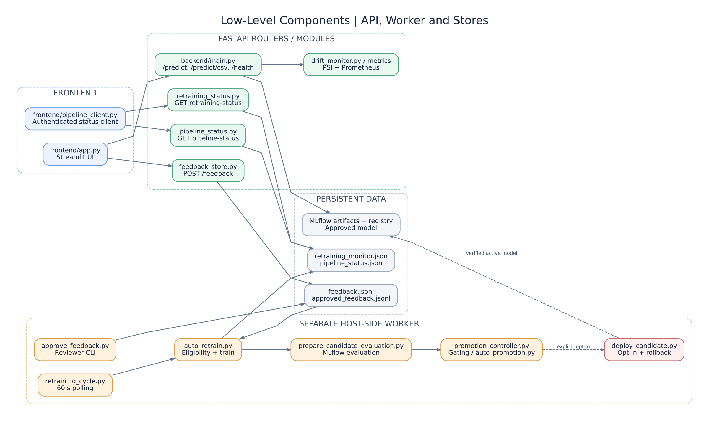
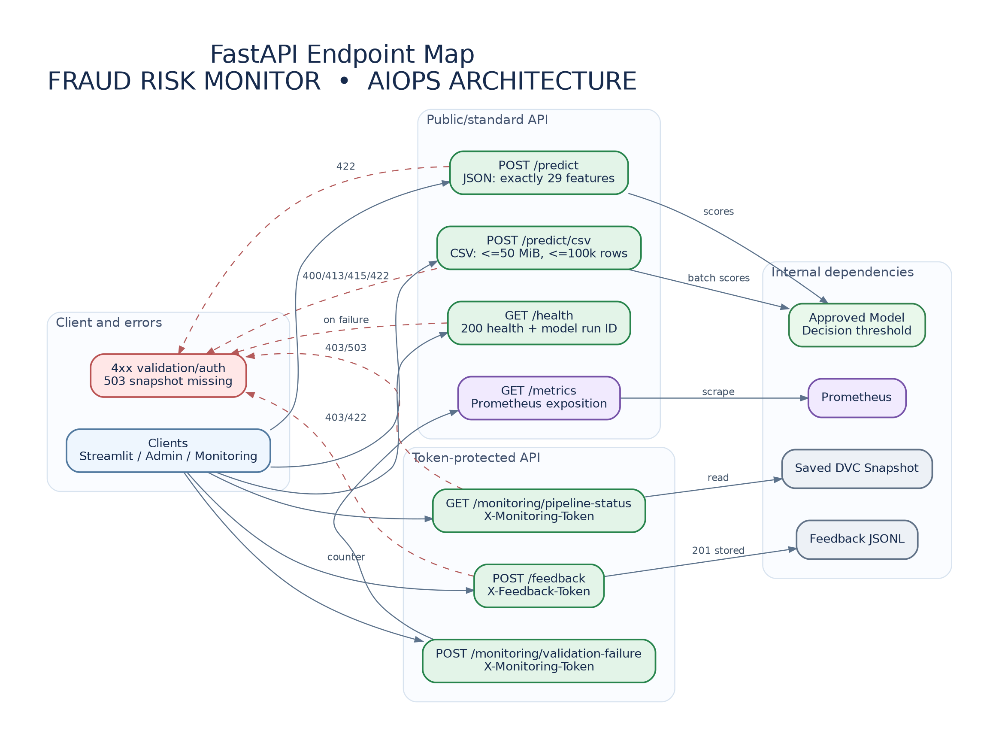

# AIOps Fraud Risk Monitor
## Low-Level Design and API Specification

**Implementation:** FastAPI, Python, MLflow, Streamlit
**Version:** 1.1 — 19 November 2026

---

## 1. Purpose

This document specifies the internal application modules,
API contracts, validation rules, security controls,
data structures and error-handling behaviour.

It describes the implemented application rather than
a proposed system.

## 2. Backend Module Structure

| Module | Responsibility |
|---|---|
| backend/main.py | API initialization, inference, CSV processing and metrics |
| backend/feedback_store.py | Feedback validation and JSONL persistence |
| backend/feedback_metrics.py | Feedback analysis and aggregation |
| backend/feedback_monitor.py | Export feedback metrics to Prometheus |
| backend/drift_monitor.py | Feature drift analysis |
| backend/pipeline_status.py | Secure pipeline snapshot retrieval |
| backend/retraining_status.py | Authenticated, read-only aggregate retraining status |
| frontend/app.py | Streamlit interface and upload workflows |
| frontend/pipeline_client.py | Pipeline and retraining-status API clients |
| scripts/approve_feedback.py | Independent confirmed-label approval |
| scripts/auto_retrain.py | Eligibility, contamination checks, candidate training and status snapshot |
| scripts/retraining_cycle.py | Host-side watcher orchestration; 60-second default poll |
| scripts/prepare_candidate_evaluation.py | Candidate evaluation preparation |
| scripts/promotion_controller.py | Quality-gated promotion eligibility checks |
| scripts/auto_promotion.py | Opt-in promotion orchestration |
| scripts/deploy_candidate.py | Deployment verification and rollback |
| scripts/deployment_env.py | Atomic active-model setting updates and recovery |
| scripts/drift_detector.py | PSI drift calculations |
| scripts/build_pipeline_status.py | Generate DVC monitoring snapshot |
| scripts/run_pipeline_stage.py | Execute and record allowed DVC stages |



## 3. Model Configuration

| Parameter | Value |
|---|---|
| Registered model | FraudRiskClassifier |
| Model version | 1 |
| Source run ID | 27da3507bddb413bab9cd0a12aeb092a |
| Decision threshold | 0.87292890258894895 |
| Input features | V1-V28 and Amount |
| Total input features | 29 |

The backend loads the approved MLflow model at startup.

The model returns an uncalibrated score.

Decision logic:

```python
decision = "review" if risk_score >= DECISION_THRESHOLD else "normal"
```

A `review` result identifies a transaction for investigation,
not confirmed fraud.

## 4. API Endpoint Summary

| Method | Path | Response |
|---|---|---|
| GET | /health | JSON health status |
| POST | /predict | JSON prediction |
| POST | /predict/csv | Downloadable CSV |
| GET | /metrics | Prometheus metrics |
| POST | /feedback | JSON acknowledgment |
| POST | /monitoring/validation-failure | HTTP 204 |
| GET | /monitoring/pipeline-status | JSON snapshot |
| GET | /monitoring/retraining-status | JSON eligibility snapshot, token-protected |

## 5. GET /health

**Purpose:** Confirm that the application has started and
identify the currently loaded model run.

Successful response: HTTP 200.

Example response:

```json
{
  "status": "ok",
  "model_run_id": "27da3507bddb413bab9cd0a12aeb092a"
}
```

The container health check calls this endpoint.

## 6. POST /predict

**Purpose:** Score one transaction.

**Content type:** application/json

Request structure:

```json
{
  "features": {
    "V1": 0.5,
    "V2": -0.3,
    "Amount": 120.0
  }
}
```

This example is deliberately abbreviated. An actual request
must contain all V1 through V28 features and Amount.

### Input validation

- All 29 feature names must be present.
- Unexpected feature names are rejected.
- All values must be finite numeric values.
- Amount must be zero or greater.
- Additional request fields are forbidden.

### Successful response

HTTP 200, application/json.

Response fields:

| Field | Type | Meaning |
|---|---|---|
| model_run_id | String | Source MLflow run |
| risk_score | Number | Uncalibrated model score |
| score_type | String | uncalibrated_model_score |
| decision_threshold | Number | Approved threshold |
| decision | String | normal or review |

### Processing logic

1. Validate the feature set.
2. Arrange features in model input order.
3. Construct a pandas DataFrame.
4. Run model.predict_proba().
5. Compare the result against the threshold.
6. Update the transaction-scoring counter.
7. Return the prediction.

Invalid values and feature sets return HTTP 422.

## 7. POST /predict/csv

**Purpose:** Score multiple transactions.

**Content type:** multipart/form-data

Required form field: `file`.

The upload must be a CSV containing exactly:

- V1 through V28
- Amount

### Upload limits

| Constraint | Value |
|---|---|
| Maximum file size | 50 MiB |
| Maximum transaction rows | 100,000 |
| Required features | 29 |
| Allowed file extension | .csv |

The API rejects missing or unexpected columns,
non-numeric or non-finite values, negative Amount values,
empty files and files exceeding configured limits.

### Successful response

HTTP 200, content type text/csv.

Filename:

`fraud_risk_predictions.csv`

The returned CSV includes the original input features
plus these columns:

| Column | Meaning |
|---|---|
| risk_score | Uncalibrated model score |
| decision_threshold | Threshold used |
| decision | normal or review |
| model_run_id | Model traceability |

Response headers:

- X-Processed-Rows
- X-Review-Count
- X-Normal-Count

### Drift analysis

When a valid CSV contains at least 100 rows,
the backend attempts PSI-based drift analysis.

Drift analysis failure does not prevent returning
successful fraud-scoring results.

### Error responses

| HTTP code | Condition |
|---|---|
| 400 | CSV cannot be parsed |
| 413 | File or row limit exceeded |
| 415 | Incorrect file extension |
| 422 | Empty CSV, invalid features or values |

## 8. POST /feedback

**Purpose:** Store a corrected transaction label.

**Authentication:** X-Feedback-Token header.

**Content type:** application/json.

### Request fields

| Field | Type | Validation |
|---|---|---|
| features | Object | Exactly V1-V28 and Amount |
| risk_score | Number | Between 0 and 1 |
| decision_threshold | Number | Between 0 and 1 |
| predicted_decision | String | normal or review |
| corrected_label | String | legitimate or fraud |
| model_run_id | String/null | Optional, maximum 100 characters |
| source_file | String/null | Optional, maximum 255 characters |
| row_number | Integer/null | Optional, minimum 1 |

The feature values must be finite.
Amount cannot be negative.
Additional request fields are forbidden.

### Successful response

HTTP 201.

```json
{
  "status": "stored",
  "feedback_id": "<generated UUID>",
  "prediction_was_correct": true
}
```

The correctness field is calculated by comparing the
predicted decision with the submitted corrected label.

The system does not independently verify the corrected label.

### Persistence

Each feedback record includes:

- Generated feedback identifier
- UTC submission timestamp
- Model run identifier
- Prediction and corrected label
- Risk score and decision threshold
- Feature values
- Optional source file and row number
- Calculated correctness indicator

Records are appended to:

`data/feedback/feedback.jsonl`

A thread lock protects writes within the API process.

## 9. POST /monitoring/validation-failure

**Purpose:** Record rejected frontend CSV or ZIP uploads.

**Authentication:** X-Monitoring-Token header.

### Request fields

| Field | Allowed values |
|---|---|
| upload_type | single_csv, bulk_zip |
| reason | missing_columns, unexpected_columns, invalid_values, negative_amount, empty_file, unreadable_file, file_limit, invalid_archive, other |

Additional request fields are forbidden.

### Response

Successful requests return HTTP 204 with no response body.

The endpoint increments the Prometheus counter
`fraud_csv_validation_failures_total`, labelled by
upload type and failure reason.

An invalid or missing monitoring token returns HTTP 403.

## 10. GET /monitoring/pipeline-status

**Purpose:** Retrieve a saved DVC pipeline snapshot.

**Authentication:** X-Monitoring-Token header.

### Processing

1. Validate the monitoring token.
2. Open the saved pipeline-status JSON file.
3. Validate the required snapshot structure.
4. Return the snapshot as JSON.

Required top-level snapshot fields include:

- schema_version
- generated_at
- overall_up_to_date
- stages

The generated snapshot can also contain recent
recorded execution results and Spark audit metadata.

The endpoint does not execute DVC or Spark commands.

### Errors

| HTTP code | Condition |
|---|---|
| 403 | Missing or incorrect monitoring token |
| 503 | Missing, unreadable or invalid snapshot |

The snapshot is mounted read-only in the backend container.

## 11. GET /monitoring/retraining-status

**Purpose:** Return the latest aggregated retraining-worker snapshot without starting any training job.

**Authentication:** `X-Monitoring-Token`. Missing, incorrect or unconfigured tokens return HTTP `403`.

**Success:** HTTP `200`, JSON with:

| Field | Type | Meaning |
|---|---|---|
| schema_version | int (1) | Status schema |
| checked_at | offset-aware ISO-8601 string | Last worker status update |
| feedback_received | nonnegative int | Received feedback records |
| not_approved | nonnegative int | Records without valid independent approval |
| invalid | nonnegative int | Records rejected by eligibility validation |
| eligible | nonnegative int | Eligible new, approved records |
| eligible_fraud | nonnegative int | Eligible fraud outcomes |
| eligible_legitimate | nonnegative int | Eligible legitimate outcomes |
| required_feedback | positive int | Minimum eligible total, default 20 |
| required_per_class | positive int | Minimum per class, default 3 |
| threshold_met | bool | Whether both minimums are satisfied |

The route reads `data/feedback/retraining_monitor.json`, checks schema consistency and returns only the authorised aggregate fields. Missing, malformed or invalid snapshots return HTTP `503`. This endpoint never reads raw feedback identities, approves labels, retrains, evaluates or deploys a model.



### Host-side retraining control flow

`approve_feedback.py` verifies reviewer approval; `auto_retrain.py` excludes pre-existing train/validation/test fingerprints and conflicting or unapproved records; `retraining_cycle.py` orchestrates candidate model training, evaluation and promotion checks; `auto_promotion.py` calls `deploy_candidate.py` only with explicit deployment opt-in (`FRAUD_AUTO_DEPLOY=1`). The active model remains unchanged by default. On explicit deployment, `deploy_candidate.py` snapshots `.env`, performs Docker recreation, verifies backend model health and attempts rollback/restoration on failure. The watcher runs on the host, outside Docker Compose and DVC.

## 12. GET /metrics

**Purpose:** Export Prometheus monitoring metrics.

**Response:** Prometheus exposition format.

The metrics include:

- fraud_api_requests_total
- fraud_api_request_duration_seconds
- fraud_transactions_scored_total
- fraud_csv_validation_failures_total
- fraud_feature_drift_psi
- fraud_drift_analyses_total
- fraud_drift_last_analysis_timestamp_seconds
- Feedback-related monitoring metrics

Prometheus scrapes the backend every 15 seconds.

## 13. Internal Prediction Logic

The backend maintains the approved model in application state.

For single transactions:

1. Validate the request schema.
2. Verify the exact expected feature set.
3. Reject non-finite values and negative Amount.
4. Construct a one-row pandas DataFrame.
5. Execute model.predict_proba().
6. Extract the positive-class score.
7. Compare the score with the configured threshold.
8. Increment the appropriate scoring counter.
9. Return the prediction response.

For CSV requests, the same model scores all validated rows.

The model is not retrained during inference.

## 14. Drift Detection Design

Drift detection uses a saved training-derived baseline.

The backend performs a PSI comparison for eligible
CSV uploads containing at least 100 transactions.

The result is classified as stable, warning or high
according to the detector implementation.

Prometheus records feature-level PSI values and
analysis outcomes.

If drift monitoring fails, the backend records the
monitoring error without failing an otherwise valid
prediction request.

## 15. Pipeline Execution Recording

The allowlisted DVC stage runner supports:

- prepare_data
- create_splits
- spark_audit
- build_drift_baseline

It records:

- Execution ID
- Stage name
- Start and finish timestamps
- Duration
- Status: succeeded, failed or skipped
- Exit code
- Execution confirmation

For successful Spark audits, the runner can also
record row count and end-to-end throughput.

Execution history is written to:

`monitoring/pipeline_executions.jsonl`

This growing local file is excluded from Git.

The snapshot generator can include the latest
20 recorded executions.

## 16. Storage Design

| Storage | Format | Purpose |
|---|---|---|
| Raw transaction data | CSV | Original dataset |
| Processed data | CSV | Prepared and split datasets |
| Spark audit | JSON | Dataset quality information |
| Drift baseline | JSON | Training reference distribution |
| MLflow tracking | SQLite | Experiments and registry metadata |
| MLflow artifacts | Files | Model and evaluation artifacts |
| Feedback | JSONL | Corrected-label records |
| Feedback approvals | JSONL | Independent reviewer approvals |
| Retraining monitor | JSON | Aggregate worker eligibility snapshot |
| Retraining state | JSON | Last processed eligible feedback set |
| Pipeline history | JSONL | Recorded DVC executions |
| Pipeline snapshot | JSON | Dashboard pipeline information |
| Alert notifications | JSONL | Received webhook alerts |

Prometheus and Grafana use Docker-managed persistent volumes.

## 17. Authentication and Security

The backend uses two separate authentication headers:

| Header | Protected operation |
|---|---|
| X-Feedback-Token | Feedback submission |
| X-Monitoring-Token | Pipeline status, retraining status and validation-failure recording |

Tokens are supplied using environment configuration
and compared using constant-time comparison.

The API rejects missing or incorrect tokens with HTTP 403.

Additional controls include:

- Input schema validation
- Maximum CSV upload limits
- Non-root backend and frontend containers
- Read-only model artifacts
- Read-only pipeline snapshot
- Localhost bindings for operational services

The deployment is designed for a local academic environment.

## 18. Error Handling

| HTTP code | Meaning |
|---|---|
| 200 | Successful prediction or read request |
| 201 | Feedback successfully stored |
| 204 | Validation-failure event recorded |
| 400 | Invalid or unreadable CSV |
| 403 | Authentication failed |
| 413 | Upload size or row-count limit exceeded |
| 415 | Unsupported file extension |
| 422 | Invalid request fields or feature values |
| 500 | Feedback persistence failure |
| 503 | Pipeline or retraining snapshot unavailable or invalid |

FastAPI may also return standard framework-level
validation errors for malformed requests.

## 19. Monitoring and Alert Processing

Prometheus collects backend and infrastructure metrics.

Grafana queries Prometheus to display operational dashboards.

Prometheus evaluates configured alert rules and
forwards matching alerts to Alertmanager.

Alertmanager routes notifications to a local webhook.

The webhook:

1. Accepts POST requests at /alerts.
2. Validates the incoming JSON alert array.
3. Extracts status, name, severity and summary.
4. Records receipt timestamps.
5. Appends notification records to JSONL storage.
6. Returns HTTP 200 when processing succeeds.

## 20. Implementation Verification

The completed system has been verified through:

- 147 passing local automated tests in the last recorded full-suite run
- Five passing targeted deployment tests following the clean-CI fixture fix
- Successful hosted GitHub Actions test and Docker jobs on commit `96b8113`
- Successful backend and frontend Docker builds
- Registered MLflow model version 1
- Four up-to-date DVC stages
- Real recorded Spark execution and throughput
- Seven running Docker services
- Successful FastAPI health checks
- Valid Prometheus alert rules
- Successful Alertmanager-to-webhook delivery

The hosted GitHub Actions workflow has passed; the complete locally verified suite includes six cases that require local datasets and approved model artifacts.

## 21. Conclusion

The low-level design implements explicit API contracts,
validated transaction inputs, controlled model inference,
token-protected monitoring, persistent feedback records
and traceable DVC execution history.

The design supports local academic deployment with
reproducible processing and operational observability.
